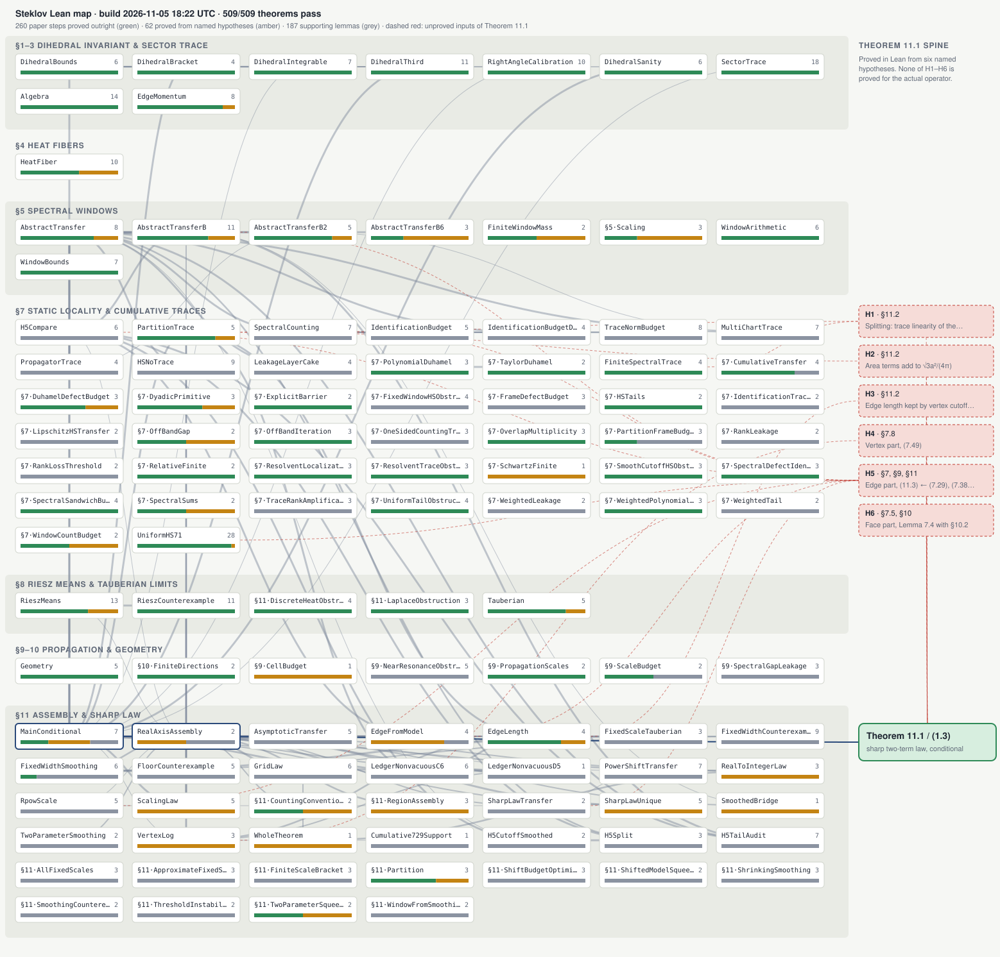

# Steklov tetrahedron: Lean verification

This Lean 4 + Mathlib (v4.35.0) project formalizes the checkable lemmas behind
"Edge spectral invariants and second-order Steklov asymptotics for the regular tetrahedron".
GitHub Actions rebuilds it and audits its axioms on every push, and every 6 hours as a safety check.

## What is and is not verified

- **Library coverage** (`verification/STATUS.md` is the authority): 488 theorem declarations
  compiled with only Lean's standard axioms at the 2026-11-05 02:12 UTC check. They cover tetrahedron counts and area, the half-angle
  identity, scale exponents, window arithmetic, finite spectral-trace localization, discrete and
  truncated Duhamel identities, finite Hilbert-Schmidt tail and spectral-gap bounds, off-band
  iteration, the Section 7 barrier inequalities, the spectral-sandwich budget, Section 9 scale and
  cell budgets, Section 10 nonreturn algebra, Section 11 partition and counting bounds, and the
  two-scale limit deductions. Several modules are deliberate obstructions (counterexamples showing
  what a uniform estimate cannot follow from).
- **Not checked:** the main theorem. `sharp_integer_law_of_two_scale` and
  `sharp_real_law_of_two_scale` assume the uniform two-scale bound as a hypothesis. Lean has no
  definition of the Dirichlet-to-Neumann operator, so the open gaps (7.2), (7.29), (7.38)/(7.45)
  and (9.1) are outside what this project proves.
- **Main-theorem inputs proved for the actual operator: 0 of 6.** The ledger `[H1]`–`[H6]` in
  `SteklovAudit/MainConditional.lean` holds only by assumption. The current priority is one of
  them, the edge comparison (7.29) (`ROADMAP.md`, section F).

## Paper proofs from the hourly runs

[`docs/paper-proofs/`](docs/paper-proofs/) records every result the hourly runs proved on paper in their
reports (57 results: statement, full proof, checks, Lean status, caveats), with an index and the findings
that bear on the manuscript.
Most of these results are not formalized in Lean; the index says which are.

## Dependency map



CI redraws this picture after every verification run. [docs/map/README.md](docs/map/README.md) lists every module with its counts and the inputs H1–H6 of Theorem 11.1 that are still unproved. [docs/map/index.html](docs/map/index.html) is the interactive version: download it and open it in a browser, or view it on GitHub Pages if Pages is enabled.

## Layout

- `SteklovAudit.lean`: all Lean modules in one file, one commented section per original module.
- `axiom_audit.py`: after `lake build`, runs `#print axioms` on every theorem and fails on `sorry` or on
  non-standard axioms. It writes `verification/STATUS.md` and `verification/STATUS.json`.
- `.github/workflows/lean.yml`: builds and audits the project, then commits the status whenever it changes.

## Running locally

With elan installed and network access to the Mathlib cache:

```
lake exe cache get && lake build && python3 axiom_audit.py
```
