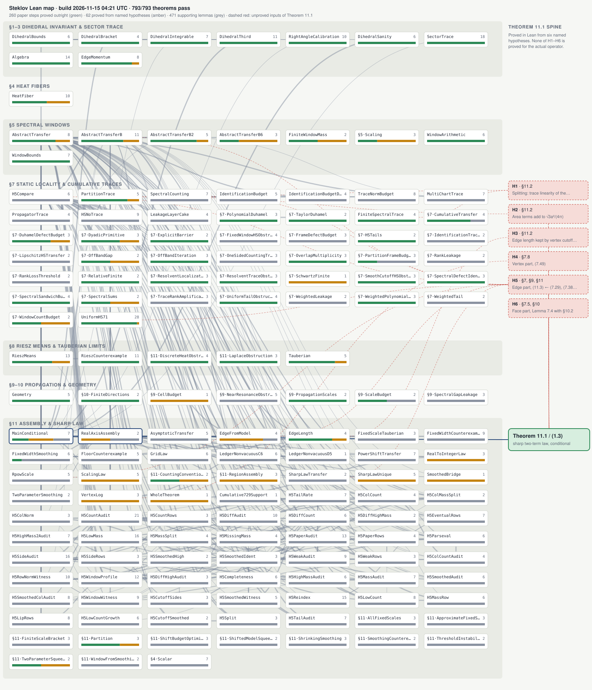

# Steklov tetrahedron: Lean verification

This Lean 4 + Mathlib (v4.35.0) project formalizes the checkable lemmas behind
"Edge spectral invariants and second-order Steklov asymptotics for the regular tetrahedron".
GitHub Actions rebuilds it and audits its axioms on every push, and every 6 hours as a safety check.

## Dependency map



Each box is a Lean module, placed in the section of the paper it formalizes. Its bar splits its theorems
into green (paper step, outright), amber (paper step, from named hypotheses) and grey (supporting). Lines
join modules that use each other. The dashed red boxes are the inputs H1–H6 of Theorem 11.1; dashed lines
point to the modules that partly reduce each.

CI redraws the picture after every verification run (`tools/build_map.py`).
[docs/map/README.md](docs/map/README.md) lists every module with its counts.
The [interactive map](https://josiahpark.github.io/steklov-lean/docs/map/) lets you click a module to list
its theorems, what each checks and where it sits in the paper.

## What is and is not verified

The numbers below are a snapshot of the 2026-11-16 map build. [`verification/STATUS.md`](verification/STATUS.md)
and [docs/map/README.md](docs/map/README.md) are regenerated after every build and are the authority.

- **Library:** 889 of 889 theorems compile with only Lean's standard axioms, in 165 modules.
  - 260 prove a step of the preprint outright.
  - 62 prove a step from the paper's analytic estimates, taken as named hypotheses.
  - 567 are supporting lemmas. Several modules are deliberate obstructions: counterexamples showing what a
    uniform estimate cannot follow from.
- **By paper section** (modules; outright / conditional / supporting theorems):

  | Section | Modules | Outright | Conditional | Supporting |
  |---|---:|---:|---:|---:|
  | §1–3 Dihedral invariant & sector trace | 9 | 83 | 1 | 0 |
  | §4 Heat fibers | 1 | 6 | 4 | 0 |
  | §5 Spectral windows | 8 | 34 | 11 | 0 |
  | §7 Static locality & cumulative traces | 44 | 86 | 8 | 82 |
  | §8 Riesz means & Tauberian limits | 5 | 31 | 5 | 0 |
  | §9–10 Propagation & geometry | 7 | 10 | 1 | 9 |
  | §11 Assembly & sharp law | 91 | 10 | 32 | 476 |
  | **Total** | **165** | **260** | **62** | **567** |

- **Not checked: the main theorem.** Theorem 11.1 is proved in Lean only from six named hypotheses H1–H6
  (`SteklovAudit/MainConditional.lean`). None of them is proved for the tetrahedron's
  Dirichlet-to-Neumann operator, which Lean has no definition of. The open gaps (7.2), (7.29),
  (7.38)/(7.45) and (9.1) are outside what this project proves.

## Inputs of Theorem 11.1 still to prove (0 of 6 done)

| Input | Paper | Statement | Lean work that reduces it |
|---|---|---|---|
| H1 | §11.2 | Splitting: trace linearity of the squared partition | `PartitionTrace`, `FiniteSpectralTrace` |
| H2 | §11.2 | Area terms add to √3a²/(4π) | `PartitionTrace` |
| H3 | §11.2 | Edge length kept by vertex cutoffs is 6a − O(ε) | `EdgeLength` |
| H4 | §7.8 | Vertex part, (7.49) | `VertexLog` |
| H5 | §7, §9, §11 | Edge part, (11.3) ← (7.29), (7.38)/(7.45), (9.1) | `EdgeFromModel`, `AbstractTransferB`, `UniformHS71`, `SpectralCounting`, `SharpLawTransfer`, `RpowScale`, `H5Compare` |
| H6 | §7.5, §10 | Face part, Lemma 7.4 with §10.2 | none yet |

Current work targets H5, the edge part: the H5 modules in §11 test which rows of its input table are
needed and which are independent. See [`ROADMAP.md`](ROADMAP.md), sections F and G.

## Paper proofs from the hourly runs

[`docs/paper-proofs/`](docs/paper-proofs/) records every result the hourly runs proved on paper in their
reports (57 results: statement, full proof, checks, Lean status, caveats), with an index and the findings
that bear on the manuscript. Most of these results are not formalized in Lean; the index says which are.
None is an estimate for the Dirichlet-to-Neumann operator of the tetrahedron.

## Layout

- `SteklovAudit.lean`: 44 of the original modules merged into one file, one commented section each.
- `SteklovAudit/`: the other 121 modules, one file each (`SteklovAudit/<Name>.lean`).
- `axiom_audit.py`: after `lake build`, runs `#print axioms` on every theorem and fails on `sorry` or on
  non-standard axioms. It writes `verification/STATUS.md` and `verification/STATUS.json`.
- `tools/build_map.py`: draws `docs/map/` from the build. `docs/map/paper_map.json` classifies theorems
  as paper steps.
- `.github/workflows/lean.yml`: builds and audits the project, then commits the status and map whenever
  they change.
- `ROADMAP.md`: the formalization plan and its checklist.

## Running locally

With elan installed and network access to the Mathlib cache:

```
lake exe cache get && lake build && python3 axiom_audit.py
```
