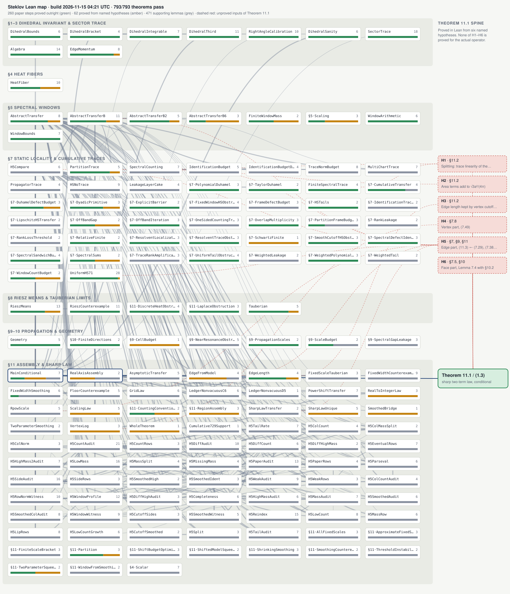

# Dependency map

Build 2026-11-25 05:19 UTC: 1385 of 1385 theorems pass. 278 prove a step of the preprint outright, 69 prove a step from the paper's analytic estimates taken as named hypotheses, and 1038 are supporting lemmas. Theorem 11.1 is proved from six named hypotheses H1–H6, none of which is yet proved for the tetrahedron's Dirichlet-to-Neumann operator.

This page, the picture below and [`index.html`](index.html) are regenerated by CI after every build (`tools/build_map.py`). The picture is static; `index.html` is the interactive version (click a module to list its theorems, what each checks and where it sits in the paper). To classify a new theorem as a paper step, add it to [`paper_map.json`](paper_map.json).

Each box is a Lean module, placed in the section of the paper it formalizes. Its bar splits its theorems into green (paper step, outright), amber (paper step, from named hypotheses) and grey (supporting). Lines join modules that use each other. The boxes on the right are H1–H6, amber where Lean work partly reduces them and grey dashed where none does yet; dashed lines point to the modules that partly reduce each.

## §1–3 Dihedral invariant & sector trace

| Module | Outright | Conditional | Supporting |
|---|---:|---:|---:|
| [`Algebra`](../../SteklovAudit.lean) | 14 | 0 | 0 |
| [`DihedralBounds`](../../SteklovAudit/DihedralBounds.lean) | 6 | 0 | 0 |
| [`DihedralBracket`](../../SteklovAudit/DihedralBracket.lean) | 4 | 0 | 0 |
| [`DihedralIntegrable`](../../SteklovAudit/DihedralIntegrable.lean) | 7 | 0 | 0 |
| [`DihedralSanity`](../../SteklovAudit/DihedralSanity.lean) | 6 | 0 | 0 |
| [`DihedralThird`](../../SteklovAudit/DihedralThird.lean) | 11 | 0 | 0 |
| [`EdgeMomentum`](../../SteklovAudit/EdgeMomentum.lean) | 7 | 1 | 0 |
| [`RightAngleCalibration`](../../SteklovAudit/RightAngleCalibration.lean) | 10 | 0 | 0 |
| [`SectorTrace`](../../SteklovAudit/SectorTrace.lean) | 18 | 0 | 0 |

## §4 Heat fibers

| Module | Outright | Conditional | Supporting |
|---|---:|---:|---:|
| [`HeatFiber`](../../SteklovAudit/HeatFiber.lean) | 6 | 4 | 0 |

## §5 Spectral windows

| Module | Outright | Conditional | Supporting |
|---|---:|---:|---:|
| [`AbstractTransfer`](../../SteklovAudit/AbstractTransfer.lean) | 6 | 2 | 0 |
| [`AbstractTransferB`](../../SteklovAudit/AbstractTransferB.lean) | 8 | 3 | 0 |
| [`AbstractTransferB2`](../../SteklovAudit/AbstractTransferB2.lean) | 4 | 1 | 0 |
| [`AbstractTransferB6`](../../SteklovAudit/AbstractTransferB6.lean) | 1 | 2 | 0 |
| [`FiniteWindowMass`](../../SteklovAudit.lean) | 1 | 1 | 0 |
| [`Section5Scaling`](../../SteklovAudit.lean) | 1 | 2 | 0 |
| [`WindowArithmetic`](../../SteklovAudit.lean) | 6 | 0 | 0 |
| [`WindowBounds`](../../SteklovAudit/WindowBounds.lean) | 7 | 0 | 0 |

## §7 Static locality & cumulative traces

| Module | Outright | Conditional | Supporting |
|---|---:|---:|---:|
| [`AbstractHSDefect`](../../SteklovAudit/AbstractHSDefect.lean) | 0 | 0 | 1 |
| [`AbstractHSDefectClosed`](../../SteklovAudit/AbstractHSDefectClosed.lean) | 0 | 0 | 2 |
| [`AffineFullTrace`](../../SteklovAudit/AffineFullTrace.lean) | 0 | 0 | 3 |
| [`AffineIdentificationNonvacuous`](../../SteklovAudit/AffineIdentificationNonvacuous.lean) | 0 | 0 | 11 |
| [`AffineParsevalDischarge`](../../SteklovAudit/AffineParsevalDischarge.lean) | 0 | 1 | 8 |
| [`AffineSpectralPassageFin`](../../SteklovAudit/AffineSpectralPassageFin.lean) | 0 | 0 | 6 |
| [`AffineWitnessFromOperator`](../../SteklovAudit/AffineWitnessFromOperator.lean) | 0 | 0 | 5 |
| [`CumulativeBudgetQuantifiers`](../../SteklovAudit/CumulativeBudgetQuantifiers.lean) | 1 | 0 | 7 |
| [`CumulativeBudgetSplit`](../../SteklovAudit/CumulativeBudgetSplit.lean) | 1 | 0 | 3 |
| [`DuhamelLocalized`](../../SteklovAudit/DuhamelLocalized.lean) | 1 | 1 | 7 |
| [`DuhamelOperatorFin`](../../SteklovAudit/DuhamelOperatorFin.lean) | 1 | 0 | 8 |
| [`DuhamelSpectral`](../../SteklovAudit/DuhamelSpectral.lean) | 2 | 0 | 1 |
| [`DuhamelWindow`](../../SteklovAudit/DuhamelWindow.lean) | 2 | 0 | 5 |
| [`FiniteSpectralTrace`](../../SteklovAudit.lean) | 4 | 0 | 0 |
| [`Foundations.AffineHarmonic3D`](../../SteklovAudit/Foundations/AffineHarmonic3D.lean) | 0 | 0 | 10 |
| [`FourierOneOverT`](../../SteklovAudit/FourierOneOverT.lean) | 1 | 0 | 3 |
| [`GrowthInputsWitness`](../../SteklovAudit/GrowthInputsWitness.lean) | 0 | 0 | 13 |
| [`H5Compare`](../../SteklovAudit/H5Compare.lean) | 0 | 0 | 6 |
| [`H5bQuantifierOrder`](../../SteklovAudit/H5bQuantifierOrder.lean) | 0 | 0 | 4 |
| [`HSBasisIndependence`](../../SteklovAudit/HSBasisIndependence.lean) | 0 | 0 | 9 |
| [`HSBasisIndependenceReal`](../../SteklovAudit/HSBasisIndependenceReal.lean) | 0 | 0 | 5 |
| [`HSNoTrace`](../../SteklovAudit/HSNoTrace.lean) | 0 | 0 | 9 |
| [`IdentificationBudget`](../../SteklovAudit/IdentificationBudget.lean) | 0 | 0 | 5 |
| [`IdentificationBudgetData`](../../SteklovAudit/IdentificationBudgetData.lean) | 0 | 0 | 4 |
| [`LeakageLayerCake`](../../SteklovAudit/LeakageLayerCake.lean) | 0 | 0 | 4 |
| [`ModelEdgeLawGammaFamily`](../../SteklovAudit/ModelEdgeLawGammaFamily.lean) | 1 | 0 | 3 |
| [`ModelEdgeLawGammaFree`](../../SteklovAudit/ModelEdgeLawGammaFree.lean) | 0 | 1 | 3 |
| [`ModelEdgeLawReduction`](../../SteklovAudit/ModelEdgeLawReduction.lean) | 2 | 1 | 7 |
| [`ModelEdgeLawSixEdges`](../../SteklovAudit/ModelEdgeLawSixEdges.lean) | 0 | 0 | 3 |
| [`MultiChartTrace`](../../SteklovAudit/MultiChartTrace.lean) | 0 | 0 | 7 |
| [`PartitionTrace`](../../SteklovAudit/PartitionTrace.lean) | 4 | 1 | 0 |
| [`PropagatorTrace`](../../SteklovAudit/PropagatorTrace.lean) | 0 | 0 | 4 |
| [`ReviewCandidates`](../../SteklovAudit/ReviewCandidates.lean) | 0 | 0 | 7 |
| [`ReviewExtensions`](../../SteklovAudit/ReviewExtensions.lean) | 2 | 2 | 2 |
| [`Section7CumulativeTransfer`](../../SteklovAudit/Section7CumulativeTransfer.lean) | 3 | 0 | 1 |
| [`Section7DuhamelDefectBudget`](../../SteklovAudit.lean) | 2 | 1 | 0 |
| [`Section7DyadicPrimitive`](../../SteklovAudit.lean) | 2 | 1 | 0 |
| [`Section7ExplicitBarrier`](../../SteklovAudit.lean) | 2 | 0 | 0 |
| [`Section7FixedWindowHSObstruction`](../../SteklovAudit/Section7FixedWindowHSObstruction.lean) | 0 | 0 | 4 |
| [`Section7FrameDefectBudget`](../../SteklovAudit.lean) | 0 | 0 | 3 |
| [`Section7HSTails`](../../SteklovAudit.lean) | 2 | 0 | 0 |
| [`Section7IdentificationTraceBudget`](../../SteklovAudit/Section7IdentificationTraceBudget.lean) | 0 | 0 | 2 |
| [`Section7LipschitzHSTransfer`](../../SteklovAudit/Section7LipschitzHSTransfer.lean) | 0 | 0 | 2 |
| [`Section7OffBandGap`](../../SteklovAudit.lean) | 1 | 1 | 0 |
| [`Section7OffBandIteration`](../../SteklovAudit.lean) | 3 | 0 | 0 |
| [`Section7OneSidedCountingTransfer`](../../SteklovAudit/Section7OneSidedCountingTransfer.lean) | 0 | 0 | 3 |
| [`Section7OverlapMultiplicity`](../../SteklovAudit.lean) | 3 | 0 | 0 |
| [`Section7PartitionFrameBudget`](../../SteklovAudit.lean) | 1 | 0 | 2 |
| [`Section7PolynomialDuhamel`](../../SteklovAudit.lean) | 3 | 0 | 0 |
| [`Section7RankLeakage`](../../SteklovAudit/Section7RankLeakage.lean) | 0 | 0 | 2 |
| [`Section7RankLossThreshold`](../../SteklovAudit.lean) | 0 | 0 | 2 |
| [`Section7RelativeFinite`](../../SteklovAudit.lean) | 2 | 0 | 0 |
| [`Section7ResolventLocalization`](../../SteklovAudit.lean) | 3 | 0 | 0 |
| [`Section7ResolventTraceObstruction`](../../SteklovAudit.lean) | 3 | 0 | 0 |
| [`Section7SchwartzFinite`](../../SteklovAudit.lean) | 0 | 1 | 0 |
| [`Section7SmoothCutoffHSObstruction`](../../SteklovAudit.lean) | 3 | 0 | 0 |
| [`Section7SpectralDefectIdentity`](../../SteklovAudit.lean) | 3 | 0 | 0 |
| [`Section7SpectralSandwichBudget`](../../SteklovAudit.lean) | 4 | 0 | 0 |
| [`Section7SpectralSums`](../../SteklovAudit.lean) | 1 | 1 | 0 |
| [`Section7TaylorDuhamel`](../../SteklovAudit.lean) | 2 | 0 | 0 |
| [`Section7TraceRankAmplification`](../../SteklovAudit/Section7TraceRankAmplification.lean) | 0 | 0 | 3 |
| [`Section7UniformTailObstruction`](../../SteklovAudit.lean) | 4 | 0 | 0 |
| [`Section7WeightedLeakage`](../../SteklovAudit/Section7WeightedLeakage.lean) | 0 | 0 | 2 |
| [`Section7WeightedPolynomialTrace`](../../SteklovAudit.lean) | 3 | 0 | 0 |
| [`Section7WeightedTail`](../../SteklovAudit.lean) | 0 | 0 | 2 |
| [`Section7WindowCountBudget`](../../SteklovAudit.lean) | 1 | 1 | 0 |
| [`SpectralCounting`](../../SteklovAudit/SpectralCounting.lean) | 0 | 0 | 7 |
| [`TaylorRemainder`](../../SteklovAudit/TaylorRemainder.lean) | 0 | 0 | 6 |
| [`TetraAssemblyFace`](../../SteklovAudit/TetraAssemblyFace.lean) | 1 | 0 | 2 |
| [`TetraEdgeLawNonvacuous`](../../SteklovAudit/TetraEdgeLawNonvacuous.lean) | 0 | 0 | 6 |
| [`TetraEdgeLawOverlap`](../../SteklovAudit/TetraEdgeLawOverlap.lean) | 1 | 0 | 1 |
| [`TraceLocalMass`](../../SteklovAudit/TraceLocalMass.lean) | 1 | 1 | 2 |
| [`TraceLocalMassGrowth`](../../SteklovAudit/TraceLocalMassGrowth.lean) | 0 | 0 | 4 |
| [`TraceNormBudget`](../../SteklovAudit/TraceNormBudget.lean) | 0 | 0 | 8 |
| [`TriangleQuadrature`](../../SteklovAudit/TriangleQuadrature.lean) | 0 | 0 | 6 |
| [`UniformHS71`](../../SteklovAudit/UniformHS71.lean) | 27 | 1 | 0 |
| [`WeightedToUnweighted`](../../SteklovAudit/WeightedToUnweighted.lean) | 0 | 0 | 3 |
| [`WeightedToUnweightedNonvacuous`](../../SteklovAudit/WeightedToUnweightedNonvacuous.lean) | 0 | 0 | 4 |
| [`WindowBoundedNonvacuous`](../../SteklovAudit/WindowBoundedNonvacuous.lean) | 0 | 0 | 3 |
| [`WindowLocalMassBounded`](../../SteklovAudit/WindowLocalMassBounded.lean) | 1 | 0 | 3 |

## §8 Riesz means & Tauberian limits

| Module | Outright | Conditional | Supporting |
|---|---:|---:|---:|
| [`RieszCounterexample`](../../SteklovAudit/RieszCounterexample.lean) | 11 | 0 | 0 |
| [`RieszMeans`](../../SteklovAudit/RieszMeans.lean) | 9 | 4 | 0 |
| [`Section11DiscreteHeatObstruction`](../../SteklovAudit.lean) | 4 | 0 | 0 |
| [`Section11LaplaceObstruction`](../../SteklovAudit.lean) | 3 | 0 | 0 |
| [`Tauberian`](../../SteklovAudit.lean) | 4 | 1 | 0 |

## §9–10 Propagation & geometry

| Module | Outright | Conditional | Supporting |
|---|---:|---:|---:|
| [`Geometry`](../../SteklovAudit.lean) | 5 | 0 | 0 |
| [`Section10FiniteDirections`](../../SteklovAudit.lean) | 2 | 0 | 0 |
| [`Section9CellBudget`](../../SteklovAudit.lean) | 0 | 1 | 0 |
| [`Section9NearResonanceObstruction`](../../SteklovAudit/Section9NearResonanceObstruction.lean) | 0 | 0 | 5 |
| [`Section9PropagationScales`](../../SteklovAudit.lean) | 2 | 0 | 0 |
| [`Section9ScaleBudget`](../../SteklovAudit.lean) | 1 | 0 | 1 |
| [`Section9SpectralGapLeakage`](../../SteklovAudit/Section9SpectralGapLeakage.lean) | 0 | 0 | 3 |

## §11 Assembly & sharp law

| Module | Outright | Conditional | Supporting |
|---|---:|---:|---:|
| [`AffineCutoffTail`](../../SteklovAudit/AffineCutoffTail.lean) | 0 | 0 | 9 |
| [`AffineEigenbasisWitness`](../../SteklovAudit/AffineEigenbasisWitness.lean) | 0 | 0 | 2 |
| [`AsymptoticTransfer`](../../SteklovAudit/AsymptoticTransfer.lean) | 0 | 0 | 5 |
| [`CountableCutoffTail`](../../SteklovAudit/CountableCutoffTail.lean) | 0 | 0 | 19 |
| [`Cumulative729Support`](../../SteklovAudit/Cumulative729Support.lean) | 0 | 0 | 1 |
| [`CumulativeBudget`](../../SteklovAudit/CumulativeBudget.lean) | 0 | 0 | 6 |
| [`CumulativeTransferAbstract`](../../SteklovAudit/CumulativeTransferAbstract.lean) | 0 | 0 | 3 |
| [`CuspBarrierSupport`](../../SteklovAudit/CuspBarrierSupport.lean) | 0 | 0 | 3 |
| [`EdgeFromModel`](../../SteklovAudit/EdgeFromModel.lean) | 0 | 3 | 1 |
| [`EdgeLength`](../../SteklovAudit/EdgeLength.lean) | 3 | 1 | 0 |
| [`FixedScaleTauberian`](../../SteklovAudit/FixedScaleTauberian.lean) | 0 | 0 | 3 |
| [`FixedTimeCumulativeRate`](../../SteklovAudit/FixedTimeCumulativeRate.lean) | 0 | 0 | 1 |
| [`FixedWidthCounterexample`](../../SteklovAudit/FixedWidthCounterexample.lean) | 0 | 0 | 9 |
| [`FixedWidthSmoothing`](../../SteklovAudit/FixedWidthSmoothing.lean) | 1 | 0 | 5 |
| [`FloorCounterexample`](../../SteklovAudit/FloorCounterexample.lean) | 0 | 0 | 5 |
| [`Foundations.DiskSteklov`](../../SteklovAudit/Foundations/DiskSteklov.lean) | 0 | 0 | 13 |
| [`Foundations.HalfPlaneDtN`](../../SteklovAudit/Foundations/HalfPlaneDtN.lean) | 0 | 0 | 7 |
| [`Foundations.Trace1D`](../../SteklovAudit/Foundations/Trace1D.lean) | 0 | 0 | 2 |
| [`Foundations.TraceHalfLine`](../../SteklovAudit/Foundations/TraceHalfLine.lean) | 0 | 0 | 2 |
| [`FullTraceSmallSeparate`](../../SteklovAudit/FullTraceSmallSeparate.lean) | 0 | 0 | 6 |
| [`GridLaw`](../../SteklovAudit/GridLaw.lean) | 0 | 0 | 6 |
| [`H5ColCount`](../../SteklovAudit/H5ColCount.lean) | 0 | 0 | 4 |
| [`H5ColCountAudit`](../../SteklovAudit/H5ColCountAudit.lean) | 0 | 0 | 4 |
| [`H5ColMassSplit`](../../SteklovAudit/H5ColMassSplit.lean) | 0 | 0 | 2 |
| [`H5ColNorm`](../../SteklovAudit/H5ColNorm.lean) | 0 | 0 | 3 |
| [`H5ColNormEv`](../../SteklovAudit/H5ColNormEv.lean) | 0 | 0 | 3 |
| [`H5ColNormEvAudit`](../../SteklovAudit/H5ColNormEvAudit.lean) | 0 | 0 | 12 |
| [`H5Completeness`](../../SteklovAudit/H5Completeness.lean) | 0 | 0 | 6 |
| [`H5CountAudit`](../../SteklovAudit/H5CountAudit.lean) | 0 | 0 | 21 |
| [`H5CountRows`](../../SteklovAudit/H5CountRows.lean) | 0 | 0 | 3 |
| [`H5CutoffAffineInstance`](../../SteklovAudit/H5CutoffAffineInstance.lean) | 0 | 0 | 3 |
| [`H5CutoffInterface`](../../SteklovAudit/H5CutoffInterface.lean) | 0 | 0 | 2 |
| [`H5CutoffObstruction`](../../SteklovAudit/H5CutoffObstruction.lean) | 0 | 0 | 13 |
| [`H5CutoffRatioSufficient`](../../SteklovAudit/H5CutoffRatioSufficient.lean) | 0 | 0 | 2 |
| [`H5CutoffSides`](../../SteklovAudit/H5CutoffSides.lean) | 0 | 0 | 3 |
| [`H5CutoffSmoothed`](../../SteklovAudit/H5CutoffSmoothed.lean) | 0 | 0 | 2 |
| [`H5CutoffSplitTerminal`](../../SteklovAudit/H5CutoffSplitTerminal.lean) | 0 | 0 | 4 |
| [`H5CutoffTerminal`](../../SteklovAudit/H5CutoffTerminal.lean) | 0 | 0 | 1 |
| [`H5CutoffTerminalIff`](../../SteklovAudit/H5CutoffTerminalIff.lean) | 0 | 0 | 2 |
| [`H5CutoffWeakRows`](../../SteklovAudit/H5CutoffWeakRows.lean) | 0 | 0 | 6 |
| [`H5DeltaVanishNeeded`](../../SteklovAudit/H5DeltaVanishNeeded.lean) | 0 | 0 | 6 |
| [`H5DiffAudit`](../../SteklovAudit/H5DiffAudit.lean) | 0 | 0 | 10 |
| [`H5DiffCount`](../../SteklovAudit/H5DiffCount.lean) | 0 | 0 | 6 |
| [`H5DiffHighAudit`](../../SteklovAudit/H5DiffHighAudit.lean) | 0 | 0 | 3 |
| [`H5DiffHighMass`](../../SteklovAudit/H5DiffHighMass.lean) | 0 | 0 | 2 |
| [`H5EvGrowWitness`](../../SteklovAudit/H5EvGrowWitness.lean) | 0 | 0 | 10 |
| [`H5EvLowCountIndep`](../../SteklovAudit/H5EvLowCountIndep.lean) | 0 | 0 | 9 |
| [`H5EvPaperScale`](../../SteklovAudit/H5EvPaperScale.lean) | 0 | 0 | 5 |
| [`H5EvPaperScaleAudit`](../../SteklovAudit/H5EvPaperScaleAudit.lean) | 0 | 0 | 7 |
| [`H5EventualAudit`](../../SteklovAudit/H5EventualAudit.lean) | 0 | 0 | 12 |
| [`H5EventualRows`](../../SteklovAudit/H5EventualRows.lean) | 0 | 0 | 7 |
| [`H5EventualTarget`](../../SteklovAudit/H5EventualTarget.lean) | 0 | 0 | 10 |
| [`H5GlobalLip`](../../SteklovAudit/H5GlobalLip.lean) | 0 | 0 | 2 |
| [`H5GlobalLipAudit`](../../SteklovAudit/H5GlobalLipAudit.lean) | 0 | 0 | 3 |
| [`H5GlobalLipRows`](../../SteklovAudit/H5GlobalLipRows.lean) | 0 | 0 | 4 |
| [`H5GlobalLipRowsAudit`](../../SteklovAudit/H5GlobalLipRowsAudit.lean) | 0 | 0 | 4 |
| [`H5GlobalLipRowsEv`](../../SteklovAudit/H5GlobalLipRowsEv.lean) | 0 | 0 | 3 |
| [`H5GlobalLipRowsEvAudit`](../../SteklovAudit/H5GlobalLipRowsEvAudit.lean) | 0 | 0 | 3 |
| [`H5GlobalLipRowsEvStrict`](../../SteklovAudit/H5GlobalLipRowsEvStrict.lean) | 0 | 0 | 4 |
| [`H5GlobalLipRowsPow`](../../SteklovAudit/H5GlobalLipRowsPow.lean) | 0 | 0 | 5 |
| [`H5GlobalLipRowsPowAudit`](../../SteklovAudit/H5GlobalLipRowsPowAudit.lean) | 0 | 0 | 3 |
| [`H5GlobalLipRowsPowStrict`](../../SteklovAudit/H5GlobalLipRowsPowStrict.lean) | 0 | 0 | 5 |
| [`H5GlobalLipRowsStrict`](../../SteklovAudit/H5GlobalLipRowsStrict.lean) | 0 | 0 | 4 |
| [`H5GlobalLipStrict`](../../SteklovAudit/H5GlobalLipStrict.lean) | 0 | 0 | 3 |
| [`H5GlobalVanishNeeded`](../../SteklovAudit/H5GlobalVanishNeeded.lean) | 0 | 0 | 3 |
| [`H5HiLinear`](../../SteklovAudit/H5HiLinear.lean) | 0 | 0 | 1 |
| [`H5HiLinearAudit`](../../SteklovAudit/H5HiLinearAudit.lean) | 0 | 0 | 4 |
| [`H5HiLinearStrict`](../../SteklovAudit/H5HiLinearStrict.lean) | 0 | 0 | 3 |
| [`H5HighMass2Audit`](../../SteklovAudit/H5HighMass2Audit.lean) | 0 | 0 | 7 |
| [`H5HighMassAudit`](../../SteklovAudit/H5HighMassAudit.lean) | 0 | 0 | 6 |
| [`H5Joint`](../../SteklovAudit/H5Joint.lean) | 0 | 0 | 1 |
| [`H5JointAudit`](../../SteklovAudit/H5JointAudit.lean) | 0 | 0 | 3 |
| [`H5JointCutoffNeeded`](../../SteklovAudit/H5JointCutoffNeeded.lean) | 0 | 0 | 3 |
| [`H5JointIff`](../../SteklovAudit/H5JointIff.lean) | 0 | 0 | 2 |
| [`H5JointSel`](../../SteklovAudit/H5JointSel.lean) | 0 | 0 | 1 |
| [`H5JointSelAudit`](../../SteklovAudit/H5JointSelAudit.lean) | 0 | 0 | 5 |
| [`H5JointSelIff`](../../SteklovAudit/H5JointSelIff.lean) | 0 | 0 | 2 |
| [`H5JointStrict`](../../SteklovAudit/H5JointStrict.lean) | 0 | 0 | 3 |
| [`H5LipRows`](../../SteklovAudit/H5LipRows.lean) | 0 | 0 | 8 |
| [`H5LowCount`](../../SteklovAudit/H5LowCount.lean) | 0 | 0 | 8 |
| [`H5LowCountGrowth`](../../SteklovAudit/H5LowCountGrowth.lean) | 0 | 0 | 6 |
| [`H5LowLinear`](../../SteklovAudit/H5LowLinear.lean) | 0 | 0 | 1 |
| [`H5LowLinearAudit`](../../SteklovAudit/H5LowLinearAudit.lean) | 0 | 0 | 5 |
| [`H5LowLinearRows`](../../SteklovAudit/H5LowLinearRows.lean) | 0 | 0 | 5 |
| [`H5LowLinearStrict`](../../SteklovAudit/H5LowLinearStrict.lean) | 0 | 0 | 5 |
| [`H5LowMass`](../../SteklovAudit/H5LowMass.lean) | 0 | 0 | 16 |
| [`H5MaskSplit`](../../SteklovAudit/H5MaskSplit.lean) | 0 | 0 | 3 |
| [`H5MassAudit`](../../SteklovAudit/H5MassAudit.lean) | 0 | 0 | 7 |
| [`H5MassEvNeeded`](../../SteklovAudit/H5MassEvNeeded.lean) | 0 | 0 | 6 |
| [`H5MassRow`](../../SteklovAudit/H5MassRow.lean) | 0 | 0 | 6 |
| [`H5MassSplit`](../../SteklovAudit/H5MassSplit.lean) | 0 | 0 | 4 |
| [`H5MissingMass`](../../SteklovAudit/H5MissingMass.lean) | 0 | 0 | 4 |
| [`H5PaperAudit`](../../SteklovAudit/H5PaperAudit.lean) | 0 | 0 | 13 |
| [`H5PaperRows`](../../SteklovAudit/H5PaperRows.lean) | 0 | 0 | 4 |
| [`H5Parseval`](../../SteklovAudit/H5Parseval.lean) | 0 | 0 | 6 |
| [`H5PinnedCutoffIsTarget`](../../SteklovAudit/H5PinnedCutoffIsTarget.lean) | 0 | 0 | 2 |
| [`H5PinnedCutoffVanish`](../../SteklovAudit/H5PinnedCutoffVanish.lean) | 0 | 0 | 3 |
| [`H5PinnedDataRows`](../../SteklovAudit/H5PinnedDataRows.lean) | 0 | 0 | 3 |
| [`H5PinnedNonvacuous`](../../SteklovAudit/H5PinnedNonvacuous.lean) | 0 | 0 | 6 |
| [`H5PinnedNotTarget`](../../SteklovAudit/H5PinnedNotTarget.lean) | 0 | 0 | 4 |
| [`H5PinnedPtsLip`](../../SteklovAudit/H5PinnedPtsLip.lean) | 0 | 0 | 4 |
| [`H5PinnedPtsLipStrict`](../../SteklovAudit/H5PinnedPtsLipStrict.lean) | 0 | 0 | 3 |
| [`H5PinnedRows`](../../SteklovAudit/H5PinnedRows.lean) | 0 | 0 | 3 |
| [`H5PinnedRowsPow`](../../SteklovAudit/H5PinnedRowsPow.lean) | 0 | 0 | 3 |
| [`H5PinnedRowsPowStrict`](../../SteklovAudit/H5PinnedRowsPowStrict.lean) | 0 | 0 | 6 |
| [`H5PinnedSumSmall`](../../SteklovAudit/H5PinnedSumSmall.lean) | 0 | 0 | 3 |
| [`H5PinnedZeroAudit`](../../SteklovAudit/H5PinnedZeroAudit.lean) | 0 | 0 | 2 |
| [`H5Reindex`](../../SteklovAudit/H5Reindex.lean) | 0 | 0 | 15 |
| [`H5RowNormEv`](../../SteklovAudit/H5RowNormEv.lean) | 0 | 0 | 3 |
| [`H5RowNormEvAudit`](../../SteklovAudit/H5RowNormEvAudit.lean) | 0 | 0 | 10 |
| [`H5RowNormWitness`](../../SteklovAudit/H5RowNormWitness.lean) | 0 | 0 | 10 |
| [`H5SelDirect`](../../SteklovAudit/H5SelDirect.lean) | 0 | 0 | 1 |
| [`H5SelDirectAudit`](../../SteklovAudit/H5SelDirectAudit.lean) | 0 | 0 | 2 |
| [`H5SelDirectIff`](../../SteklovAudit/H5SelDirectIff.lean) | 0 | 0 | 2 |
| [`H5SelMin`](../../SteklovAudit/H5SelMin.lean) | 0 | 0 | 3 |
| [`H5SelMinStrict`](../../SteklovAudit/H5SelMinStrict.lean) | 0 | 0 | 5 |
| [`H5SideAudit`](../../SteklovAudit/H5SideAudit.lean) | 0 | 0 | 16 |
| [`H5SideRows`](../../SteklovAudit/H5SideRows.lean) | 0 | 0 | 3 |
| [`H5SmoothedAudit`](../../SteklovAudit/H5SmoothedAudit.lean) | 0 | 0 | 6 |
| [`H5SmoothedColAudit`](../../SteklovAudit/H5SmoothedColAudit.lean) | 0 | 0 | 8 |
| [`H5SmoothedHigh`](../../SteklovAudit/H5SmoothedHigh.lean) | 0 | 0 | 2 |
| [`H5SmoothedIdent`](../../SteklovAudit/H5SmoothedIdent.lean) | 0 | 0 | 3 |
| [`H5SmoothedWitness`](../../SteklovAudit/H5SmoothedWitness.lean) | 0 | 0 | 5 |
| [`H5Split`](../../SteklovAudit/H5Split.lean) | 0 | 0 | 3 |
| [`H5TailAudit`](../../SteklovAudit/H5TailAudit.lean) | 0 | 0 | 7 |
| [`H5TailEv`](../../SteklovAudit/H5TailEv.lean) | 0 | 0 | 1 |
| [`H5TailEvAudit`](../../SteklovAudit/H5TailEvAudit.lean) | 0 | 0 | 3 |
| [`H5TailEvStrict`](../../SteklovAudit/H5TailEvStrict.lean) | 0 | 0 | 3 |
| [`H5TailRate`](../../SteklovAudit/H5TailRate.lean) | 0 | 0 | 7 |
| [`H5WeakAudit`](../../SteklovAudit/H5WeakAudit.lean) | 0 | 0 | 9 |
| [`H5WeakRows`](../../SteklovAudit/H5WeakRows.lean) | 0 | 0 | 3 |
| [`H5WindowProfile`](../../SteklovAudit/H5WindowProfile.lean) | 0 | 0 | 12 |
| [`H5WindowWitness`](../../SteklovAudit/H5WindowWitness.lean) | 0 | 0 | 9 |
| [`LedgerNonvacuousC6`](../../SteklovAudit/LedgerNonvacuousC6.lean) | 0 | 0 | 6 |
| [`LedgerNonvacuousD5`](../../SteklovAudit/LedgerNonvacuousD5.lean) | 0 | 0 | 1 |
| [`MainConditional`](../../SteklovAudit/MainConditional.lean) | 2 | 3 | 2 |
| [`PowerShiftTransfer`](../../SteklovAudit/PowerShiftTransfer.lean) | 0 | 0 | 7 |
| [`RealAxisAssembly`](../../SteklovAudit.lean) | 0 | 1 | 1 |
| [`RealToIntegerLaw`](../../SteklovAudit/RealToIntegerLaw.lean) | 0 | 3 | 0 |
| [`ResidualLink`](../../SteklovAudit/ResidualLink.lean) | 0 | 0 | 10 |
| [`RpowScale`](../../SteklovAudit/RpowScale.lean) | 0 | 0 | 5 |
| [`ScalingLaw`](../../SteklovAudit/ScalingLaw.lean) | 0 | 5 | 0 |
| [`Section11AllFixedScales`](../../SteklovAudit/Section11AllFixedScales.lean) | 0 | 0 | 3 |
| [`Section11ApproximateFixedScales`](../../SteklovAudit/Section11ApproximateFixedScales.lean) | 0 | 0 | 3 |
| [`Section11CountingConventions`](../../SteklovAudit.lean) | 1 | 1 | 0 |
| [`Section11FiniteScaleBracket`](../../SteklovAudit/Section11FiniteScaleBracket.lean) | 0 | 0 | 3 |
| [`Section11Partition`](../../SteklovAudit.lean) | 2 | 1 | 0 |
| [`Section11RegionAssembly`](../../SteklovAudit.lean) | 0 | 3 | 0 |
| [`Section11ShiftBudgetOptimization`](../../SteklovAudit/Section11ShiftBudgetOptimization.lean) | 0 | 0 | 3 |
| [`Section11ShiftedModelSqueeze`](../../SteklovAudit/Section11ShiftedModelSqueeze.lean) | 0 | 0 | 2 |
| [`Section11ShrinkingSmoothing`](../../SteklovAudit/Section11ShrinkingSmoothing.lean) | 0 | 0 | 3 |
| [`Section11SmoothingCounterexample`](../../SteklovAudit/Section11SmoothingCounterexample.lean) | 0 | 0 | 2 |
| [`Section11ThresholdInstability`](../../SteklovAudit/Section11ThresholdInstability.lean) | 0 | 0 | 2 |
| [`Section11TwoParameterSqueeze`](../../SteklovAudit.lean) | 1 | 1 | 0 |
| [`Section11WindowFromSmoothing`](../../SteklovAudit/Section11WindowFromSmoothing.lean) | 0 | 0 | 2 |
| [`Section4Scalar`](../../SteklovAudit/Section4Scalar.lean) | 0 | 0 | 7 |
| [`SharpLawTransfer`](../../SteklovAudit/SharpLawTransfer.lean) | 0 | 0 | 2 |
| [`SharpLawUnique`](../../SteklovAudit/SharpLawUnique.lean) | 0 | 5 | 0 |
| [`SmoothedBridge`](../../SteklovAudit.lean) | 0 | 1 | 0 |
| [`TetraAffineFlux`](../../SteklovAudit/TetraAffineFlux.lean) | 0 | 0 | 6 |
| [`TwoParameterSmoothing`](../../SteklovAudit/TwoParameterSmoothing.lean) | 0 | 0 | 2 |
| [`VertexLog`](../../SteklovAudit/VertexLog.lean) | 0 | 3 | 0 |
| [`WedgeChannel`](../../SteklovAudit/WedgeChannel.lean) | 0 | 0 | 15 |
| [`WholeTheorem`](../../SteklovAudit.lean) | 0 | 1 | 0 |
| [`WindowDefectFullTrace`](../../SteklovAudit/WindowDefectFullTrace.lean) | 0 | 0 | 3 |
| [`WindowLittleOMass`](../../SteklovAudit/WindowLittleOMass.lean) | 0 | 0 | 3 |

## Inputs of Theorem 11.1 still to prove

| Input | Paper | Statement | Lean work that reduces it |
|---|---|---|---|
| H1 | §11.2 | Splitting: trace linearity of the squared partition | `PartitionTrace`, `FiniteSpectralTrace` |
| H2 | §11.2 | Area terms add to √3a²/(4π) | `PartitionTrace` |
| H3 | §11.2 | Edge length kept by vertex cutoffs is 6a − O(ε) | `EdgeLength` |
| H4 | §7.8 | Vertex part, (7.49) | `VertexLog` |
| H5 | §7, §9, §11 | Edge part, (11.3) ← (7.29), (7.38)/(7.45), (9.1) | `EdgeFromModel`, `AbstractTransferB`, `UniformHS71`, `SpectralCounting`, `SharpLawTransfer`, `RpowScale`, `H5Compare` |
| H6 | §7.5, §10 | Face part, Lemma 7.4 with §10.2 | none yet |
