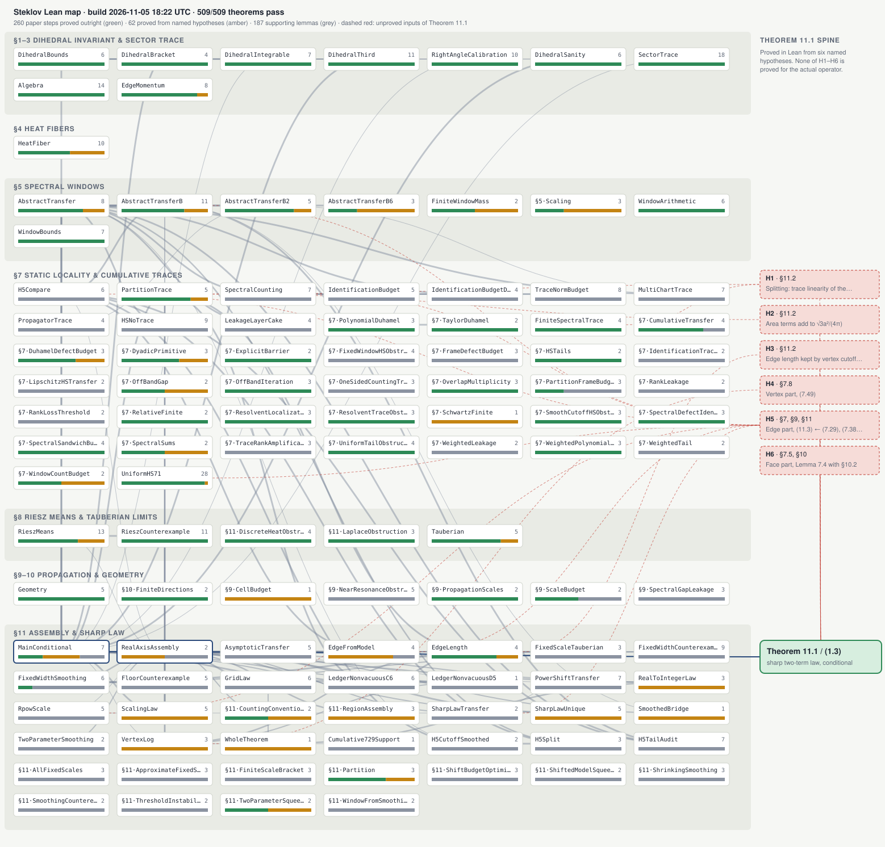

# Dependency map

Build 2026-11-05 21:52 UTC: 0 of 531 theorems pass. 0 prove a step of the preprint outright, 0 prove a step from the paper's analytic estimates taken as named hypotheses, and 531 are supporting lemmas. Theorem 11.1 is proved from six named hypotheses H1–H6, none of which is yet proved for the tetrahedron's Dirichlet-to-Neumann operator.

This page, the picture below and [`index.html`](index.html) are regenerated by CI after every build (`tools/build_map.py`). The picture is static; `index.html` is the interactive version (click a module to list its theorems, what each checks and where it sits in the paper). To classify a new theorem as a paper step, add it to [`paper_map.json`](paper_map.json).

Each box is a Lean module, placed in the section of the paper it formalizes. Its bar splits its theorems into green (paper step, outright), amber (paper step, from named hypotheses) and grey (supporting). Lines join modules that use each other. The dashed red boxes are H1–H6; dashed lines point to the modules that partly reduce each.

## §1–3 Dihedral invariant & sector trace

| Module | Outright | Conditional | Supporting |
|---|---:|---:|---:|
| [`Algebra`](../../SteklovAudit.lean) | 0 | 0 | 14 |
| [`DihedralBounds`](../../SteklovAudit/DihedralBounds.lean) | 0 | 0 | 6 |
| [`DihedralBracket`](../../SteklovAudit/DihedralBracket.lean) | 0 | 0 | 4 |
| [`DihedralIntegrable`](../../SteklovAudit/DihedralIntegrable.lean) | 0 | 0 | 7 |
| [`DihedralSanity`](../../SteklovAudit/DihedralSanity.lean) | 0 | 0 | 6 |
| [`DihedralThird`](../../SteklovAudit/DihedralThird.lean) | 0 | 0 | 11 |
| [`EdgeMomentum`](../../SteklovAudit/EdgeMomentum.lean) | 0 | 0 | 8 |
| [`RightAngleCalibration`](../../SteklovAudit/RightAngleCalibration.lean) | 0 | 0 | 10 |
| [`SectorTrace`](../../SteklovAudit/SectorTrace.lean) | 0 | 0 | 18 |

## §4 Heat fibers

| Module | Outright | Conditional | Supporting |
|---|---:|---:|---:|
| [`HeatFiber`](../../SteklovAudit/HeatFiber.lean) | 0 | 0 | 10 |

## §5 Spectral windows

| Module | Outright | Conditional | Supporting |
|---|---:|---:|---:|
| [`AbstractTransfer`](../../SteklovAudit/AbstractTransfer.lean) | 0 | 0 | 8 |
| [`AbstractTransferB`](../../SteklovAudit/AbstractTransferB.lean) | 0 | 0 | 11 |
| [`AbstractTransferB2`](../../SteklovAudit/AbstractTransferB2.lean) | 0 | 0 | 5 |
| [`AbstractTransferB6`](../../SteklovAudit/AbstractTransferB6.lean) | 0 | 0 | 3 |
| [`FiniteWindowMass`](../../SteklovAudit.lean) | 0 | 0 | 2 |
| [`Section5Scaling`](../../SteklovAudit.lean) | 0 | 0 | 3 |
| [`WindowArithmetic`](../../SteklovAudit.lean) | 0 | 0 | 6 |
| [`WindowBounds`](../../SteklovAudit/WindowBounds.lean) | 0 | 0 | 7 |

## §7 Static locality & cumulative traces

| Module | Outright | Conditional | Supporting |
|---|---:|---:|---:|
| [`FiniteSpectralTrace`](../../SteklovAudit.lean) | 0 | 0 | 4 |
| [`H5Compare`](../../SteklovAudit/H5Compare.lean) | 0 | 0 | 6 |
| [`HSNoTrace`](../../SteklovAudit/HSNoTrace.lean) | 0 | 0 | 9 |
| [`IdentificationBudget`](../../SteklovAudit/IdentificationBudget.lean) | 0 | 0 | 5 |
| [`IdentificationBudgetData`](../../SteklovAudit/IdentificationBudgetData.lean) | 0 | 0 | 4 |
| [`LeakageLayerCake`](../../SteklovAudit/LeakageLayerCake.lean) | 0 | 0 | 4 |
| [`MultiChartTrace`](../../SteklovAudit/MultiChartTrace.lean) | 0 | 0 | 7 |
| [`PartitionTrace`](../../SteklovAudit/PartitionTrace.lean) | 0 | 0 | 5 |
| [`PropagatorTrace`](../../SteklovAudit/PropagatorTrace.lean) | 0 | 0 | 4 |
| [`Section7CumulativeTransfer`](../../SteklovAudit/Section7CumulativeTransfer.lean) | 0 | 0 | 4 |
| [`Section7DuhamelDefectBudget`](../../SteklovAudit.lean) | 0 | 0 | 3 |
| [`Section7DyadicPrimitive`](../../SteklovAudit.lean) | 0 | 0 | 3 |
| [`Section7ExplicitBarrier`](../../SteklovAudit.lean) | 0 | 0 | 2 |
| [`Section7FixedWindowHSObstruction`](../../SteklovAudit/Section7FixedWindowHSObstruction.lean) | 0 | 0 | 4 |
| [`Section7FrameDefectBudget`](../../SteklovAudit.lean) | 0 | 0 | 3 |
| [`Section7HSTails`](../../SteklovAudit.lean) | 0 | 0 | 2 |
| [`Section7IdentificationTraceBudget`](../../SteklovAudit/Section7IdentificationTraceBudget.lean) | 0 | 0 | 2 |
| [`Section7LipschitzHSTransfer`](../../SteklovAudit/Section7LipschitzHSTransfer.lean) | 0 | 0 | 2 |
| [`Section7OffBandGap`](../../SteklovAudit.lean) | 0 | 0 | 2 |
| [`Section7OffBandIteration`](../../SteklovAudit.lean) | 0 | 0 | 3 |
| [`Section7OneSidedCountingTransfer`](../../SteklovAudit/Section7OneSidedCountingTransfer.lean) | 0 | 0 | 3 |
| [`Section7OverlapMultiplicity`](../../SteklovAudit.lean) | 0 | 0 | 3 |
| [`Section7PartitionFrameBudget`](../../SteklovAudit.lean) | 0 | 0 | 3 |
| [`Section7PolynomialDuhamel`](../../SteklovAudit.lean) | 0 | 0 | 3 |
| [`Section7RankLeakage`](../../SteklovAudit/Section7RankLeakage.lean) | 0 | 0 | 2 |
| [`Section7RankLossThreshold`](../../SteklovAudit.lean) | 0 | 0 | 2 |
| [`Section7RelativeFinite`](../../SteklovAudit.lean) | 0 | 0 | 2 |
| [`Section7ResolventLocalization`](../../SteklovAudit.lean) | 0 | 0 | 3 |
| [`Section7ResolventTraceObstruction`](../../SteklovAudit.lean) | 0 | 0 | 3 |
| [`Section7SchwartzFinite`](../../SteklovAudit.lean) | 0 | 0 | 1 |
| [`Section7SmoothCutoffHSObstruction`](../../SteklovAudit.lean) | 0 | 0 | 3 |
| [`Section7SpectralDefectIdentity`](../../SteklovAudit.lean) | 0 | 0 | 3 |
| [`Section7SpectralSandwichBudget`](../../SteklovAudit.lean) | 0 | 0 | 4 |
| [`Section7SpectralSums`](../../SteklovAudit.lean) | 0 | 0 | 2 |
| [`Section7TaylorDuhamel`](../../SteklovAudit.lean) | 0 | 0 | 2 |
| [`Section7TraceRankAmplification`](../../SteklovAudit/Section7TraceRankAmplification.lean) | 0 | 0 | 3 |
| [`Section7UniformTailObstruction`](../../SteklovAudit.lean) | 0 | 0 | 4 |
| [`Section7WeightedLeakage`](../../SteklovAudit/Section7WeightedLeakage.lean) | 0 | 0 | 2 |
| [`Section7WeightedPolynomialTrace`](../../SteklovAudit.lean) | 0 | 0 | 3 |
| [`Section7WeightedTail`](../../SteklovAudit.lean) | 0 | 0 | 2 |
| [`Section7WindowCountBudget`](../../SteklovAudit.lean) | 0 | 0 | 2 |
| [`SpectralCounting`](../../SteklovAudit/SpectralCounting.lean) | 0 | 0 | 7 |
| [`TraceNormBudget`](../../SteklovAudit/TraceNormBudget.lean) | 0 | 0 | 8 |
| [`UniformHS71`](../../SteklovAudit/UniformHS71.lean) | 0 | 0 | 28 |

## §8 Riesz means & Tauberian limits

| Module | Outright | Conditional | Supporting |
|---|---:|---:|---:|
| [`RieszCounterexample`](../../SteklovAudit/RieszCounterexample.lean) | 0 | 0 | 11 |
| [`RieszMeans`](../../SteklovAudit/RieszMeans.lean) | 0 | 0 | 13 |
| [`Section11DiscreteHeatObstruction`](../../SteklovAudit.lean) | 0 | 0 | 4 |
| [`Section11LaplaceObstruction`](../../SteklovAudit.lean) | 0 | 0 | 3 |
| [`Tauberian`](../../SteklovAudit.lean) | 0 | 0 | 5 |

## §9–10 Propagation & geometry

| Module | Outright | Conditional | Supporting |
|---|---:|---:|---:|
| [`Geometry`](../../SteklovAudit.lean) | 0 | 0 | 5 |
| [`Section10FiniteDirections`](../../SteklovAudit.lean) | 0 | 0 | 2 |
| [`Section9CellBudget`](../../SteklovAudit.lean) | 0 | 0 | 1 |
| [`Section9NearResonanceObstruction`](../../SteklovAudit/Section9NearResonanceObstruction.lean) | 0 | 0 | 5 |
| [`Section9PropagationScales`](../../SteklovAudit.lean) | 0 | 0 | 2 |
| [`Section9ScaleBudget`](../../SteklovAudit.lean) | 0 | 0 | 2 |
| [`Section9SpectralGapLeakage`](../../SteklovAudit/Section9SpectralGapLeakage.lean) | 0 | 0 | 3 |

## §11 Assembly & sharp law

| Module | Outright | Conditional | Supporting |
|---|---:|---:|---:|
| [`AsymptoticTransfer`](../../SteklovAudit/AsymptoticTransfer.lean) | 0 | 0 | 5 |
| [`Cumulative729Support`](../../SteklovAudit/Cumulative729Support.lean) | 0 | 0 | 1 |
| [`EdgeFromModel`](../../SteklovAudit/EdgeFromModel.lean) | 0 | 0 | 4 |
| [`EdgeLength`](../../SteklovAudit/EdgeLength.lean) | 0 | 0 | 4 |
| [`FixedScaleTauberian`](../../SteklovAudit/FixedScaleTauberian.lean) | 0 | 0 | 3 |
| [`FixedWidthCounterexample`](../../SteklovAudit/FixedWidthCounterexample.lean) | 0 | 0 | 9 |
| [`FixedWidthSmoothing`](../../SteklovAudit/FixedWidthSmoothing.lean) | 0 | 0 | 6 |
| [`FloorCounterexample`](../../SteklovAudit/FloorCounterexample.lean) | 0 | 0 | 5 |
| [`GridLaw`](../../SteklovAudit/GridLaw.lean) | 0 | 0 | 6 |
| [`H5CutoffSmoothed`](../../SteklovAudit/H5CutoffSmoothed.lean) | 0 | 0 | 2 |
| [`H5LipRows`](../../SteklovAudit/H5LipRows.lean) | 0 | 0 | 8 |
| [`H5Split`](../../SteklovAudit/H5Split.lean) | 0 | 0 | 3 |
| [`H5TailAudit`](../../SteklovAudit/H5TailAudit.lean) | 0 | 0 | 7 |
| [`H5WindowProfile`](../../SteklovAudit/H5WindowProfile.lean) | 0 | 0 | 7 |
| [`LedgerNonvacuousC6`](../../SteklovAudit/LedgerNonvacuousC6.lean) | 0 | 0 | 6 |
| [`LedgerNonvacuousD5`](../../SteklovAudit/LedgerNonvacuousD5.lean) | 0 | 0 | 1 |
| [`MainConditional`](../../SteklovAudit/MainConditional.lean) | 0 | 0 | 7 |
| [`PowerShiftTransfer`](../../SteklovAudit/PowerShiftTransfer.lean) | 0 | 0 | 7 |
| [`RealAxisAssembly`](../../SteklovAudit.lean) | 0 | 0 | 2 |
| [`RealToIntegerLaw`](../../SteklovAudit/RealToIntegerLaw.lean) | 0 | 0 | 3 |
| [`RpowScale`](../../SteklovAudit/RpowScale.lean) | 0 | 0 | 5 |
| [`ScalingLaw`](../../SteklovAudit/ScalingLaw.lean) | 0 | 0 | 5 |
| [`Section11AllFixedScales`](../../SteklovAudit/Section11AllFixedScales.lean) | 0 | 0 | 3 |
| [`Section11ApproximateFixedScales`](../../SteklovAudit/Section11ApproximateFixedScales.lean) | 0 | 0 | 3 |
| [`Section11CountingConventions`](../../SteklovAudit.lean) | 0 | 0 | 2 |
| [`Section11FiniteScaleBracket`](../../SteklovAudit/Section11FiniteScaleBracket.lean) | 0 | 0 | 3 |
| [`Section11Partition`](../../SteklovAudit.lean) | 0 | 0 | 3 |
| [`Section11RegionAssembly`](../../SteklovAudit.lean) | 0 | 0 | 3 |
| [`Section11ShiftBudgetOptimization`](../../SteklovAudit/Section11ShiftBudgetOptimization.lean) | 0 | 0 | 3 |
| [`Section11ShiftedModelSqueeze`](../../SteklovAudit/Section11ShiftedModelSqueeze.lean) | 0 | 0 | 2 |
| [`Section11ShrinkingSmoothing`](../../SteklovAudit/Section11ShrinkingSmoothing.lean) | 0 | 0 | 3 |
| [`Section11SmoothingCounterexample`](../../SteklovAudit/Section11SmoothingCounterexample.lean) | 0 | 0 | 2 |
| [`Section11ThresholdInstability`](../../SteklovAudit/Section11ThresholdInstability.lean) | 0 | 0 | 2 |
| [`Section11TwoParameterSqueeze`](../../SteklovAudit.lean) | 0 | 0 | 2 |
| [`Section11WindowFromSmoothing`](../../SteklovAudit/Section11WindowFromSmoothing.lean) | 0 | 0 | 2 |
| [`Section4Scalar`](../../SteklovAudit/Section4Scalar.lean) | 0 | 0 | 7 |
| [`SharpLawTransfer`](../../SteklovAudit/SharpLawTransfer.lean) | 0 | 0 | 2 |
| [`SharpLawUnique`](../../SteklovAudit/SharpLawUnique.lean) | 0 | 0 | 5 |
| [`SmoothedBridge`](../../SteklovAudit.lean) | 0 | 0 | 1 |
| [`TwoParameterSmoothing`](../../SteklovAudit/TwoParameterSmoothing.lean) | 0 | 0 | 2 |
| [`VertexLog`](../../SteklovAudit/VertexLog.lean) | 0 | 0 | 3 |
| [`WholeTheorem`](../../SteklovAudit.lean) | 0 | 0 | 1 |

## Inputs of Theorem 11.1 still to prove

| Input | Paper | Statement | Lean work that reduces it |
|---|---|---|---|
| H1 | §11.2 | Splitting: trace linearity of the squared partition | `PartitionTrace`, `FiniteSpectralTrace` |
| H2 | §11.2 | Area terms add to √3a²/(4π) | `PartitionTrace` |
| H3 | §11.2 | Edge length kept by vertex cutoffs is 6a − O(ε) | `EdgeLength` |
| H4 | §7.8 | Vertex part, (7.49) | `VertexLog` |
| H5 | §7, §9, §11 | Edge part, (11.3) ← (7.29), (7.38)/(7.45), (9.1) | `EdgeFromModel`, `AbstractTransferB`, `UniformHS71`, `SpectralCounting`, `SharpLawTransfer`, `RpowScale`, `H5Compare` |
| H6 | §7.5, §10 | Face part, Lemma 7.4 with §10.2 | none yet |
